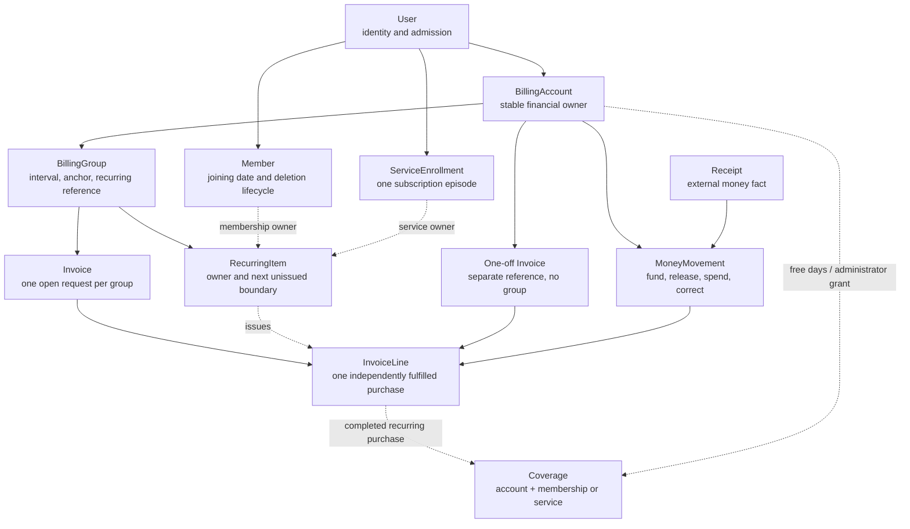
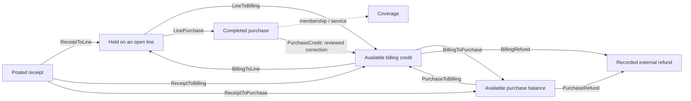

# Billing, membership and services: a code guide

This guide explains the implemented business logic for new developers and
reviewers. It follows the code in `src/Nulysa`, with billing as the main thread:
how purchases are requested, how money becomes coverage, and how membership and
service lifecycles constrain those operations. It describes the current S0–S2
implementation, rather than features proposed for later slices.

For setup and configuration, use the [billing walkthrough](billing.md),
[membership guide](membership.md) and [operations runbook](operations.md). The
[specification](../AGENTS/SPEC.md), [billing design](../AGENTS/BILLING_DESIGN.md)
and [service design](../AGENTS/SERVICE_DESIGN.md) provide policy background.

Read the [concepts](#1-the-concepts-to-keep-separate),
[code map](#2-where-the-logic-lives) and [records](#3-how-the-records-fit-together)
first. Then use the sections on [dates and pricing](#4-dates-calendars-and-quoted-prices),
[money](#5-money-receipt-hold-purchase-coverage), [workflows](#6-the-main-workflows),
[lifecycles](#7-membership-and-service-lifecycle-decisions),
[corrections](#8-corrections-and-one-off-requests),
[safeguards](#9-transaction-retry-and-database-safeguards),
[queries and delivery](#10-read-models-reconciliation-and-delivery), and
[review/tests](#11-reading-and-reviewing-a-change) as needed.

## 1. The concepts to keep separate

The system manages advance purchases. An unpaid request can expire without
becoming debt. A member's financial position and eligibility are built from
several different facts:

| Question | Source of truth |
| --- | --- |
| May this person log in? | Admission and pending deletion on `User`, checked through account authorization. Nonpayment does not disable login. |
| What should be billed next? | A `RecurringItem`, its billing group/calendar, existing requests and coverage. |
| What was offered for purchase? | An `InvoiceLine`, including its quoted pricing, dates and purchase purpose. |
| What money actually arrived? | A `Receipt` with stable external identity and booked date. A receipt awaiting review is not spendable member money. |
| Where is posted money now? | `MoneyMovement` journal entries: available balances, held line funding, purchases and refunds. |
| What benefit was purchased or granted? | Dated `Coverage`, for membership or a stable service identity. |
| May this service be used today? | A current subscription, active membership, and service coverage or applicable renewal grace. |

In particular, an invoice is not a receipt, held funds are not a completed
purchase, and coverage is not by itself a complete service-use decision.
Membership standing and service standing are derived results; there is no stored
paid-through counter or universal active flag.

The code also separates **issuing a request**, **fulfilling a purchase**, and
**using the benefit now**. New subscriptions need active membership. Completing
an already-authorized service purchase checks the live account and subscription,
but does not call the service-use predicate. It can buy future time, or preserve
a purchase while membership use is temporarily blocked.

## 2. Where the logic lives

Nulysa is one ASP.NET Core application with a shared EF Core `AppDbContext` and
PostgreSQL database. Web and background-worker processes use the same commands.
The web UI primarily uses Blazor static SSR forms. Quartz persists scheduled
work in the same database; the worker executes it separately from web requests.

The service folder currently contains records. Subscription commands and
cross-module financial orchestration live in the partial `BillingCommands`
class. There is no separate service command layer or `Flows` implementation to
find in this checkout.

| Start here | Responsibility and useful entry points |
| --- | --- |
| [BillingCommands.cs](../src/Nulysa/Billing/BillingCommands.cs) | Shared write primitives: account locking, operations, `Initialize`, `Issue`, `Complete`, `Requote`, `CloseLine`, `Finish`. |
| [BillingPayments.cs](../src/Nulysa/Billing/BillingPayments.cs) | `Import`/`Match`, reference routing, `PrepareRequestsForReceipt`, `PostReceipt`, allocation order, the `Change` transaction wrapper, transfers, refunds and receipt reversals. |
| [ReceiptDestination.cs](../src/Nulysa/Billing/ReceiptDestination.cs) | The four typed receipt purposes, form-selection validation and the retained operation-fingerprint format. |
| [BillingFunding.cs](../src/Nulysa/Billing/BillingFunding.cs) | `Fund`, read-only `ResolveFundingQuote`/`QuoteUnquotedDays`, and recurring `AllocateCredit`. |
| [BillingRecovery.cs](../src/Nulysa/Billing/BillingRecovery.cs) | `AssessRecovery` and its named blockers, restoring expired requests, and reopening automatically ended subscriptions. |
| [BillingLifecycle.cs](../src/Nulysa/Billing/BillingLifecycle.cs) | `Scan`, renewal issuance, expiry, subscription changes, membership returns and deletion/restoration integration. Also contains `BillingDueWorkJob`. |
| [BillingCreditLots.cs](../src/Nulysa/Billing/BillingCreditLots.cs) | Recovery of missed renewals using the dates and remaining amounts of receipt-derived credit. |
| [BillingAdjustments.cs](../src/Nulysa/Billing/BillingAdjustments.cs) | One-offs, cancellations, discounts, coverage extensions, reviewed credits, service configuration and dated prices. |
| [BillingFacts.cs](../src/Nulysa/Billing/BillingFacts.cs), [Standing.cs](../src/Nulysa/Billing/Standing.cs) | One account's loaded facts, journal-derived balances, membership/service evaluation, and typed standing with separate display text. |
| [CalendarPricing.cs](../src/Nulysa/Billing/CalendarPricing.cs) | Pure calendar, uncovered-period, pricing and discount-credit calculations, plus payment-reference helpers. |
| [Billing records](../src/Nulysa/Billing/Records.cs), [BillingAccount.cs](../src/Nulysa/Billing/BillingAccount.cs), [service records](../src/Nulysa/Services/Records.cs) | Persisted financial and subscription vocabulary. [BillingMapping.cs](../src/Nulysa/Billing/BillingMapping.cs) supplies constraints and relationships. |
| [MembershipCommands.cs](../src/Nulysa/Membership/MembershipCommands.cs) | Admission and the member lifecycle: `Approve`, `BeginDeletion`, `Restore`, `Erase`, and the common member lock order. |
| [BillingQueries.cs](../src/Nulysa/Billing/BillingQueries.cs) | Authorized account/invoice views, forecasts, balance statements, reconciliation and CSV exports. |
| [MemberPortalQueries.cs](../src/Nulysa/Billing/MemberPortalQueries.cs), [AdministrationBillingQueries.cs](../src/Nulysa/Billing/AdministrationBillingQueries.cs), [MembershipQueries.cs](../src/Nulysa/Membership/MembershipQueries.cs) | Purpose-specific portal/admin projections and registry standing. |
| [BankFeed.cs](../src/Nulysa/Integrations/BankFeed.cs) | GoCardless booked-transaction parsing, synchronization status and alerts; delegates money handling to `BillingCommands.Import`. |
| [InvoicePdf.cs](../src/Nulysa/Billing/InvoicePdf.cs), [communications](../src/Nulysa/Communications/) | Rendering and delivery of financial communications after domain decisions. |

[FoundationHost.cs](../src/Nulysa/FoundationHost.cs) registers these services,
validates settings and maps PDF/export endpoints.
[Schedules.cs](../src/Nulysa/Operations/Schedules.cs) defines maintenance timing.
For UI callers, start with [Billing.razor](../src/Nulysa/Components/Pages/Billing.razor),
[BillingAdministration.razor.cs](../src/Nulysa/Components/Pages/BillingAdministration.razor.cs)
and [ReceiptReview.razor.cs](../src/Nulysa/Components/Pages/ReceiptReview.razor.cs).
Forms collect and preview intent; commands enforce authorization and current facts
again when saving.

## 3. How the records fit together



This is a reading map, not a complete schema. Arrows show ownership or flow;
dotted arrows describe decisions that create or connect records.

`ServiceDefinition` gives a service its stable code and subscription policy:
self-subscription, free days, renewal grace, funding priority and retirement.
Its associated `FeeDefinition` supplies the billing identity, display name and
category; `FeePrice` and `Discount` supply dated pricing. Each service has one
recurring fee. Service identity therefore survives a price or name change.

### Financial ownership and renewal instructions

`BillingAccount` is the durable financial owner. Its nullable `UserId` connects
it to the current member; financial records survive erasure of that user. It
also owns the purchase-deposit reference and invoice-email preference.

A `BillingGroup` is unique per account and interval in months. Membership and
services with the same interval share its recurring reference and open invoice.
All groups retain the member's joining-date anchor. Changing an interval selects
or creates another group for the instruction; already-issued lines remain on
their original invoices with their existing quotes and references.

A `RecurringItem` authorizes future requests for exactly one typed owner:
membership or a service enrollment. `NextUnissuedPeriodStartsOn` advances when a line is issued and
can be corrected when its period changes. It is a scheduling boundary, not proof
that time was paid for. The property's `MembershipUserId` references `Member.UserId`.
The C# names retain the existing `NextOn` and `MembershipId` database columns
through explicit mappings; these names do not require a schema migration.
The membership fee is the special fee with ID `1`; it has no service definition.

### Requests, purchases and history

`Invoice` groups lines for presentation and payment routing. Recurring invoices
use their group's reference; one-offs have their own reference. `DueOn` is
derived from the earliest open line's due date. `ClosedAt` means there are no
open lines: an invoice can close through fulfilment, cancellation, expiry, or a
mixture of these outcomes.

`InvoiceLine` is the unit of purchase and fulfilment. Its `Benefit` identifies
membership, service or one-off; `Purpose` distinguishes initial, renewal,
alignment, resumption and one-off requests. It retains descriptions/categories,
current and original periods, pricing segments, due/expiry dates and funding
dates. `PurchaseKey` deduplicates a logical purchase independently of the invoice
that happens to contain it. A resumption key includes the operation ID so a
later deliberate return can be a new request.

A line normally moves from `Open` to `Fulfilled`, `Cancelled` or `Expired`.
Recovery using timely receipts or receipt-derived credit lots can reopen an expired line.
Cancellation and expiry release holds; fulfilment consumes them. A fulfilled
line is never reopened by these commands.

`LineAdjustment` retains the previous amount, period and pricing when an open
line changes. Fulfilled purchases and their coverage are preserved; adjustments
to their financial outcome use additional journal entries.

`Coverage` targets the billing account and either membership or a stable
`ServiceDefinition`, rather than one subscription episode. This lets a returning
subscriber reuse surviving service coverage without creating new paid time.
Purchased coverage links to its fulfilled line; initial free days and
administrator grants link to their operation without a fake receipt.

`ServiceEnrollment` records one subscription episode, including renewal-stop
intent, first paid date, end time and typed `ServiceEndReason`. The enum maps to the existing stored/audit
codes such as `nonpayment` and `administrator-removal`. `ServiceChange` records its
changes under billing operation IDs. Ending the episode does not delete its
financial history or underlying coverage.

## 4. Dates, calendars and quoted prices

### Date boundaries

`AssociationClock.Today` is the business date in the configured association time
zone, defaulting to `Europe/Helsinki`. `Now` is the audit timestamp. Business dates
use `DateOnly`; timestamps use `DateTimeOffset`.

Coverage, discount and pricing periods use `[start, end)`: the start is included
and the end is excluded. Payment due dates are inclusive. `PaymentCutoffExclusive` is the
exclusive cutoff, so funding is timely when its effective date is **before**
`PaymentCutoffExclusive`.

The code names upper boundaries explicitly: `Coverage.EndExclusive`,
`Discount.EndExclusive`, `Period.EndExclusive` and `PriceSegment.EndExclusive`
exclude that day. `Standing.ActiveUntilExclusive` bounds benefit availability,
including grace. `InvoiceLine.PaymentCutoffExclusive` is the first day funding
is too late. Inclusive `DueOn`/`ChargeDueOn` remain deadlines stated as “pay by.”

Portal, administration, invoice PDF and grace-mail displays convert an exclusive
end to the last included day. Paid/granted standing says “Covered through”; grace
says “Benefits available through,” without describing grace as purchased time.
For example, coverage ending on December 1 is shown as covered through November
30; a renewal due December 1 with zero grace is payable on December 1 and has a
December 2 cutoff. The discount form also accepts an inclusive “Through” date
and adds one day at the command boundary. One-off requests show their payment
deadline rather than presenting a coverage period.

The database columns (`EndsOn`, `OriginalEndsOn`, `ExpiresOn`, `OldEnd`, `NewEnd`)
and saved quote JSON keys (`End`, `BasisEnd`) retain their original names through
explicit mappings. This preserves financial history without a schema/data
migration. Machine-readable journal CSV period ends remain exclusive; the
inclusive wording applies to human-facing displays.

| Request | Due date and expiry |
| --- | --- |
| Initial membership | Due on joining date plus `InitialMembershipGraceDays` (default 14); expires the following day. Initial nonpayment does not add renewal grace. |
| Membership return | Due on return-request start plus the same initial window; expires the following day. The request itself grants no active standing. |
| Initial service | Has its own `ServicePaymentWindowDays` window from issuance (default 14). The due date is the earlier of that date and the quoted period end. Expiry preserves the window and is always after the due date. Free coverage is independent of this deadline. |
| Membership/service renewal or alignment | Due at the uncovered period start. Expires at `due + 1 + graceDays`, using membership settings or the service's grace setting. |
| One-off | Due on the selected future date; expires the following day. |

For example, a renewal due on July 1 with seven grace days accepts funding through
July 8 and expires on July 9. Zero grace still permits payment on July 1. Issued
lines keep their stored deadlines when configuration changes.

### Calendar phase and pricing basis

`BillingCalendar.Containing` computes boundaries directly from the original
anchor and interval. A January 31 monthly anchor returns to March 31 after
February; repeatedly adding a month to the previous clipped date would drift.
Quarterly and other intervals retain that same joining-date phase.

`Bridge` prices from an intermediate start to the next boundary. Initial service
and alignment paths merge a bridge shorter than seven days with one additional
period. A membership resumption uses its prorated bridge without that short-period
merge. Existing paid or granted days are removed through `Uncovered`.

`Pricing.Calculate` splits uncovered time at calendar boundaries, dated price
changes and discount boundaries. Each `PriceSegment` retains the full interval's
basis dates, base price, discounted price and discount identity. Its contribution
is:

```text
segment price × segment days / basis-period days
```

The full interval price is monthly price times interval months. Contributions
are summed before rounding to cents, with midpoint rounding away from zero.
This uses actual days in the anchored interval, including for partial periods.

`FeePrice` is dated configuration; `Discount` is an account/fee-specific percentage
or replacement monthly price. Active discounts for the same account/fee cannot
overlap. Prices must exist for the time being quoted: migrations seed the
membership fee identity, but no price. Missing prices can therefore roll back
admission or subscription.

An issued quote retains its basis. `SetPrice` adds a dated price and does not
rewrite existing lines. Discount changes deliberately reprice unfinished future
time through `Pricing.Adjust`; past segments retain their quote. Withdrawal takes
effect from the current association-local date. Fully discounted purchases can
complete and create coverage with no money movements.

## 5. Money: receipt, hold, purchase, coverage

`Receipt` records a source transaction, including outgoing and non-EUR entries
that cannot become member funding. Its source identity, amount, currency, booked
date, reference, message and counterparty are retained unchanged on reimport.
Its matching state and account assignment can change through explicit commands.

`MoneyMovement` is the financial journal. Amounts are positive decimal EUR values
with at most two decimal places; `MovementKind` supplies the direction. Balances
and per-line holds are sums over this journal, computed by `BillingFacts`.
Commands append movements rather than overwriting balances.



The diagram omits receipt-allocation reversal entries, described below. These
are reservations and financial classifications; recording an internal movement
does not make a bank transfer.

Available billing credit is automatically usable for recurring requests.
Purchase balance is an optional deliberate-deposit balance, enabled by
`PurchaseBalanceEnabled`; it is never automatically swept into bills. An explicit
purchase-to-billing transfer makes that money available to the recurring
allocator immediately. Held and spent funds cannot be transferred or refunded.

Partial funding stays held on a line and buys no proportional time. Once fully
funded, `Complete` spends the hold and grants coverage for the pricing segments
atomically. Other lines need not be funded first. A one-off completes through
the same funding path but creates no recurring coverage.

For example, with a EUR 10 membership line and EUR 30 service line in the same
invoice, a EUR 15 receipt completes membership and holds EUR 5 for the service.
A further EUR 30 completes the service and leaves EUR 5 billing credit. If the
service request is cancelled after the first payment instead, its EUR 5 hold is
released to billing credit and membership coverage remains intact.

### Allocation order and the effective funding date

`OrderedLines` orders invoices by earliest open charge due date, then issue time
and ID. Within each invoice it orders membership first, then configured service
priority, due date and line ID. Thus membership priority applies within the bill;
the allocator also respects ordering between bills.

A referenced receipt first targets its selected recurring group or one-off
invoice. Any excess becomes billing credit, after which ordinary credit
allocation can fund recurring bills across groups. `AllocateCredit` excludes
one-off invoices, so existing credit does not automatically pay a one-off.

`Fund` uses the later of the incoming funding date and `LastFundingOn`. An
out-of-order import cannot move completion earlier than money already required
for that purchase. Direct receipts use their booked date; ordinary credit
application and transfers use the application date.

For initial service and membership-resumption lines, `ResolveFundingQuote`
returns a proposed `FundingQuote` containing the quote and period without
changing domain facts. `Fund` accepts that proposal only when available funds
suffice, then reserves money and completes the funded purchase. The event's
`fundsAvailableOn` date is distinct from the derived `effectiveFundingOn`, which
also accounts for previous funding.
Coverage already granted is excluded. Initial membership and renewal purchases
retain their original period: payment during renewal grace purchases from the
renewal boundary, rather than starting a new period on payment day.

Routine scans do not shorten a quote daily until a partial payment happens to
suffice. There is a separate initial-service rollover path when its quoted
period has ended but the payment window is still open. Delayed funding can use
retained adjustment/original pricing for earlier quoted days; genuinely unquoted
days use dated prices and discount history, including the local withdrawal date.

## 6. The main workflows

### Admission creates the first real request

`MembershipCommands.Approve` locks the application, checks live board authority,
and deduplicates approval by application ID. In one transaction it creates the
Identity user, `Member.JoinedOn`, ID-only approval audit and `BillingAccount`.
It then calls `BillingCommands.Initialize` before removing the application and
queuing welcome mail.

`Initialize` creates/consumes the `InitialMembershipRequest` handover, creates the
membership recurring item and issues the initial membership line. It expires
already-obsolete requests, applies available credit and finalizes invoice state
and notifications. The request's invoice ID is stored atomically. Cancelled or
already-consumed handovers are not reissued. `Scan` can also consume an unfinished
handover using its retained anchor and approval time.

The initial invoice and mail scheduling are part of admission's transaction.
Missing prices or scheduling failure roll back admission as well. Initial
membership standing comes from the initial open-line grace, not fictitious paid
coverage.

### Importing and matching a payment

```mermaid
sequenceDiagram
    participant Source as Bank feed / administrator
    participant Import as BillingCommands.Import
    participant DB as PostgreSQL
    participant Match as Match / allocation
    Source->>Import: Booked transaction with stable source identity
    Import->>DB: Lock source identity; insert or verify receipt
    DB-->>Import: Commit receipt fact
    Import->>Match: Match receipt ID in a separate transaction
    Match->>DB: Lock destination account, then receipt; reload facts
    alt Cannot apply automatically
        Match->>DB: Persist Review with reason; commit
    else Valid destination and incoming EUR
        Match->>DB: Recover timely requests where safe
        Match->>DB: Append funding, purchase and excess-credit movements
        Match->>DB: Create coverage; finalize invoice state; commit
    end
```

`Import` validates the external input and serializes imports on
`(Source, SourceAccount, ExternalId)` with a PostgreSQL advisory lock. A unique
index backs that identity. An exact reimport reuses the receipt; conflicting
source facts fail instead of overwriting history. The receipt is committed before
matching, so its existence does not depend on successful allocation.

`Match` normalizes the reference and resolves a recurring group, one-off invoice
or purchase-deposit account. It does not infer ownership from payer name or
amount. Unknown references, unavailable/pending-deletion accounts, outgoing
entries, unsupported currencies and disabled deposits persist in `Review` with
a reason. A persisted `New` receipt is also visible in payment review if matching
was interrupted.

Manual `AssignReceipt` requires board authority, a reason, an operation key and
one `ReceiptDestination`: `RecurringGroup`, `OneOffInvoice`, `PurchaseDeposit`,
or `BillingCredit`. Only the form-selection adapter accepts nullable selections;
the financial workflow receives one typed purpose. Destination ownership is
rechecked under the account lock. The serialized operation input retains its
previous shape so an existing operation key still recognizes an identical retry. `IgnoreReceipt` retains the source
fact without posting money. Automatic reimport matching only processes `New`;
reviewed and ignored receipts do not silently become posted after circumstances
change. A posted receipt requires reversal before a different assignment.

For a valid receipt, `Match` owns the account/receipt locks and transaction.
`PrepareRequestsForReceipt` handles timely recovery, expiry, unissued renewals
and possible membership resumption before posting. `PostReceipt` posts the
receipt, funds destination lines, records excess credit, then runs
recovery/expiry/allocation again. Finalization checks the financial invariants
before commit. A reference can identify an expired request without making that
old request payable: genuinely late money may instead remain credit or fund an
authorized membership return.

### Renewal and expiry are reconciliation from dated facts

`BillingDueWorkJob` visits attached accounts in batches of 50, giving each account
a fresh dependency scope and transaction through `Scan`. A failed account is
logged and does not prevent later accounts from being processed; the job reports
an aggregate failure afterward. It also checks bank-feed staleness.

For a live account, `Scan` follows this order:

1. Consume any unfinished initial handover and return if that path applies.
2. Issue eligible renewals within `InvoiceLeadDays` (default 14).
3. Recover missed renewals using eligible receipt-derived credit lots.
4. Expire requests, send applicable notices and end subscriptions whose time is over.
5. Allocate available billing credit, derive invoice state, queue invoice mail and
   verify balances.

Renewal issuance skips ended instructions and retired fees. Service renewal also
requires an unended, renewing enrollment with a first paid purchase and active
membership. An existing open line prevents another line for that instruction.
An expired/cancelled previous request with uncovered time blocks ordinary
continuation, rather than creating an accumulating debt stream. Catch-up is
bounded, including at most 24 issuance iterations per item per call; zero-price
periods can catch up without fabricated payments.

`Expire` releases open-line holds before changing line state. It can end service
enrollments even if no renewal invoice was ever issued. Membership grace and
inactivity notices have their own deduplication markers/keys, including the
missed-renewal-without-a-line case. The minute-level schedule is a wake-up:
persisted dates and purchase identities determine what work is due.

### Delayed facts and credit lots

Import time is not payment time. A receipt imported after expiry may still have
been booked before the original cutoff. `AssessRecovery` returns a
`RecoveryDecision` with a named blocker for ended membership, later purchases,
closed/newer subscriptions or unavailable released funds. When allowed, `Recover`
can reopen an automatically expired line and its automatically ended service episode, restoring
released holds when safe. Explicit cancellation/removal, a newer conflicting
purchase or subscription, and released money subsequently spent elsewhere can
prevent recovery. Conflicting delayed receipts remain in manual review.

Receipt-derived excess credit also has provenance: `CreditLot` retains its
receipt date and remaining amount. `Move` creates lots for `ReceiptToBilling`
and consumes lots oldest first when credit leaves the balance. Lots are not a
second authoritative balance: corrections and transfers can produce billing
credit without receipt lots.

`RecoverMissedRenewalsWithLots` handles renewals missed during an outage. It
requires enough remaining lot money dated before the renewal cutoff, works
through missed periods in date/priority order, and checks historical membership
eligibility for services. Transfers and ordinary adjustments do not acquire an
old deposit date for this purpose. Recovery is bounded and deliberately narrower
than replaying every historical event.

## 7. Membership and service lifecycle decisions

### Membership standing and returns

`Standing.State` distinguishes covered time, initial membership grace, renewal
grace, inactivity and unavailable accounts, as well as service-specific states.
`Active`, `IsMembershipGrace` and the existing display descriptions are derived
from that state. `IsMembershipGrace` includes both initial and renewal windows;
service grace does not trigger membership attention or mail.

`BillingFacts.MembershipStanding` first rejects an unavailable account, then
looks for current membership coverage. Without coverage it can grant standing
from a valid open initial/renewal/alignment line; resumption is excluded. It can
also derive renewal grace from the previous coverage end and a live renewal
instruction when a worker has not issued the next line yet. A cancelled or
expired request at that boundary suppresses this fallback.

After nonpayment, membership continues as an admitted relationship and login
remains available. Benefits and ordinary paid renewal billing pause. A
`ResumeMembership` request quotes the uncovered return period on the original
calendar. It uses normal funding and fulfilment; merely requesting it does not
reactivate standing, and the unpaid gap is not billed retroactively.

With `AutomaticMembershipReactivation` enabled, a qualifying payment to the
membership instruction's group can trigger that return request. When disabled,
an administrator must request the return. Neither path restores removed optional
services, and pending deletion cannot be resolved by payment.

### Subscription, free time and use

`Subscribe` requires a live account, active membership, an available service and
no current enrollment for that service. Self-subscription must be enabled or
the actor must be an administrator. It creates an enrollment, recurring item and
initial request, then applies credit in the same transaction.

Configured introductory days are actual coverage, normally once per account and
service. A returning subscriber does not get another trial just by opening a new
episode. An explicit administrator flag can grant the configured days again as
an audited administrator grant. Retained service coverage is reused and is not
charged again. Free time can outlast the initial request's payment window: the
request can expire while the free benefit remains usable.

`BillingFacts.Service` evaluates use in this order: current enrollment, active
membership, current paid/granted service coverage, then applicable renewal grace.
An initial unpaid service has no extra grace-based access; it needs free or paid
coverage. Established-service grace requires a first paid purchase and no
renewal-stop intent. It can be derived even when a renewal invoice is missing.
This standing is the implemented service-benefit decision; resource-specific
door or qualification checks are outside this implementation.

| Change | Requests and subscription | Existing coverage |
| --- | --- | --- |
| Membership nonpayment | Blocks service use and new service requests; existing service requests retain their deadlines. The subscription can survive while it still has time. | Continues expiring on calendar dates. Membership return can restore use while the episode and coverage/grace still survive. |
| Service nonpayment | Once there is no remaining coverage, valid initial request or renewal grace, `EndService` ends the episode and instruction and expires unfinished lines. | Purchased/free time is retained; expiry does not erase it. A later ordinary return requires a new subscription, subject to the usual approval rules. |
| Stop renewal | Records `RenewalStoppedAt`, ends instructions, cancels unfinished lines and releases holds. The episode stays until remaining coverage ends. | Usable until its end, subject to membership standing. No new unpaid grace is granted. |
| Administrator immediate removal | Ends the episode immediately and cancels unfinished lines. | Retained as financial/benefit history; it does not override the ended-enrollment use gate. |
| Retire service | Retires the service and its fee, hiding new subscription choices and preventing new renewal requests. Existing episodes/issued requests remain subject to normal lifecycle rules. | Paid time remains usable; retirement does not itself erase or refund it. |

### Deletion, restoration and retained funds

`MembershipCommands.BeginDeletion` immediately marks the account unavailable,
rotates its security stamp and revokes upstream tokens/authorizations. Under the
same transaction, `CancelForDeletion` ends current services/instructions, cancels
unfinished lines and releases holds. The initial handover is cancelled and
unnecessary pending mail is replaced with a deletion warning. Purchased coverage
and unspent money are retained.

Administrator `Restore` clears the deletion gate before actual erasure. If
membership coverage still exists today, `RestoreMembershipBilling` creates a new
membership instruction after the contiguous covered time, reusing the previous
group/calendar. It does not reopen cancelled requests or removed services. If
coverage has expired, restoration grants no coverage or grace; the separate
membership-return path applies. Receipts put into review during deletion remain
there until explicit repair.

`Erase` rechecks waiting-time eligibility under locks, removes personal,
authentication and subscription/instruction records, and detaches the financial
account through its nullable user relationship. Lines retain their financial
facts even when instruction/enrollment links are cleared. If an unspent balance
remains, only the name/email needed for that claim is copied to `BillingAccount`.
Refunding or reversing the last available funds clears those claim fields.
Rejoining creates new IDs and a new account; email never relinks the old claim.

## 8. Corrections and one-off requests

These operations use the ordinary account transaction and journal. Administrative
corrections require a reason. The UI previews named actions without writing and
rechecks the selected effect on confirmation; the commands remain responsible
for correctness if called outside that UI.

| Operation | Business effect |
| --- | --- |
| `OneOff` | Creates an administrator-issued request with its own reference, fixed amount/category and deadline. Uses normal holds/completion, without a recurring instruction, recurring-credit sweep or coverage. |
| `CancelInvoice` | Cancels only open lines and returns their holds to billing credit. Completed purchases survive. Released credit can fund other recurring requests. |
| `AddDiscount` / `WithdrawDiscount` | Adjust unfinished future time using retained quote bases, record line revisions and release surplus holds. A now-zero-price purchase can complete without cash. |
| `GrantMembershipMonths` | Requires current paid/granted membership coverage and appends 1–120 whole months after contiguous coverage. Reprices unfinished requests to exclude granted days, releasing unnecessary holds. Grace alone is insufficient. |
| `CreditFutureDiscount` | Requires a fulfilled purchase and applicable future discount. Computes only the remaining reduction after earlier date-specific credits, requires the reviewed amount to match, and appends `PurchaseCredit` into billing credit. Original purchase and coverage remain intact. |
| `UnassignReceipt` | Reverses eligible allocations with linked reversal movements, cancels affected unfinished lines and returns the receipt to review. Rejects a receipt that directly funded a fulfilled line or whose required funds are unavailable. Reassignment is a separate action. |
| `Refund` | Records an already-completed external refund from available billing or purchase balance. It does not send money or consume held/spent funds. |

This is why an incorrect completed purchase cannot be fixed by changing a receipt
amount, deleting coverage or making a balance negative. The supported commands
preserve source facts and completed history; cases outside their rules require
treasurer reconciliation.

## 9. Transaction, retry and database safeguards

Most account commands use `Change`: begin a transaction, enlist Quartz, lock and
reload the billing account, check live authority, validate the operation key,
apply the change, `Finish`, and commit. `Match`, `Scan` and membership commands
have their own outer transactions because their workflows have different lock
and persistence needs. `Initialize` and lifecycle integration methods participate
in their caller's transaction.

The account row serializes journal writes and balance decisions. Membership
commands consistently lock **billing account, then user**; receipt matching locks
**billing account, then receipt**. `BillingCommands.Lock` clears the EF change
tracker before loading account facts, so callers cannot assume tracked objects
survive this boundary. External bank HTTP calls occur outside member locks.

Advisory locks use the explicit API in
[DatabaseLocks.cs](../src/Nulysa/Data/DatabaseLocks.cs). Both acquisition methods
require an existing EF transaction, parameterize the SQL and hold the lock until
commit or rollback. `Acquire` takes one of these named `DatabaseLock` purposes:

| Purpose | PostgreSQL key | Coordinating operations |
| --- | --- | --- |
| `ScheduleInstallation` | `(0, 1)` | Maintenance schedule installation. |
| `RoleAdministration` | `(0, 2)` | Operator role creation and assignment/revocation. |
| `MailDispatchRate` | `(0, 3)` | Shared mail-rate window initialization and updates. |
| `FeeCatalog` | `(0, 4)` | Service/fee configuration and dated price changes. |

The first integer is the fixed-lock namespace; the second is the centrally
assigned resource ID. The former `72134501`–`72134504` values had no documented
prefix meaning and have been replaced. These are transient locks, not stored
financial identifiers; the change needs no database migration.

`AcquireForIdentity` retains the existing 64-bit PostgreSQL hash of a canonical
identity: normalized email for application/admission coordination, or the JSON
source/account/transaction tuple for receipt import. PostgreSQL's two-integer
and single-bigint advisory key spaces do not overlap, so fixed-purpose locks
cannot collide with these hashed identities. Hash collisions between identities
can only serialize otherwise unrelated work. See the
[PostgreSQL advisory-lock reference](https://www.postgresql.org/docs/18/functions-admin.html#FUNCTIONS-ADVISORY-LOCKS).
The API acquires locks without owning the transaction; the caller still controls
commit, rollback and lock order. Advisory locks only coordinate cooperating
callers and do not block ordinary queries or replace database constraints.

`BillingOperation` groups the effects of one action. Its caller-provided UUID is
an idempotency key, checked against account, kind and a hash of input, actor and
reason. An identical retry returns the stored result; reusing the key for a
different action fails. Automatic maintenance uses fresh operation IDs and
deduplicates actual purchases/grants through logical keys and persisted dates.
Receipt source identities, approval IDs and delivery IDs provide separate
deduplication boundaries.

Database constraints are a second defense. Important examples include:

- One open invoice per recurring group, one current subscription per member/service,
  and one live recurring instruction per typed owner.
- Exactly one membership/service owner per instruction, and exactly one recurring
  group/one-off reference route per invoice.
- Unique source receipt identity, purchase key and coverage origin; once-only
  introductory coverage per account/service.
- Positive journal amounts and required typed links for funding, purchases,
  corrections and reversals; restrictive deletion for financial records.

`Finish` derives due/closed state and checks that available balances and holds
are nonnegative, that non-open lines have no holds, and that remaining receipt
lots do not exceed available billing credit. Lots need not equal that balance,
because some credit has other origins. Broken invariants throw and roll back;
invalid caller inputs produce validation errors; valid external facts that cannot
be applied are retained in review.

Quartz execution can occur more than once. Cluster scheduling alone does not
make financial effects exactly once: account locks, operation keys and unique
logical facts provide the business safeguards. Mail intents and Quartz work are
committed with their domain change through transaction enlistment. Sending to
SMTP remains a separate external effect.

## 10. Read models, reconciliation and delivery

`BillingQueries` composes invoices, line funding, coverage, standing, subscriptions,
forecasts, operations and per-balance statements. Forecasts reuse calendar and
pricing functions but do not issue requests or move money. Statements order
movements by effective date and ID, exposing both effective and recorded times.
Purpose-specific portal/registry queries reuse the shared standing evaluator with
smaller input projections. Ordinary views are read models, not account-write
locks or accounting snapshots.

`Reconcile` deliberately uses one PostgreSQL repeatable-read snapshot so concurrent
allocation cannot appear as a discrepancy between its queries. Its lifetime
conservation check is:

```text
posted receipts + purchase credits
    = available billing credit + available purchase balance
      + held funds + completed purchases + recorded refunds
```

It also reports invalid line holds and receipts whose net allocations do not
match their posted state. The difference should be zero and both invalid lists
empty. It reports discrepancies without repairing them. Journal and source-bank
CSV exports are separate, bounded by effective and booked dates respectively,
with an exclusive end date and escaping for formula-like source text. They are
not a general ledger or an accountant-approved period-close report.

`Finish` queues invoice email for a changed open invoice revision when notifications
are enabled for the command and the account wants invoice email. Matching finishes
without queuing invoice notifications; queued stale revisions are checked at
dispatch. `NotifiedRevision` tracks the queued revision, while the `Delivery`
record tracks the actual delivery outcome. Disabling invoice email does not
suppress mandatory membership notices.

`MailRenderer` rechecks ownership, account availability, preference, invoice
revision and open state before rendering invoice mail. `InvoicePdf` renders
structured data through the trusted Typst template and verifies the revision
before/after rendering. PDF generation neither reprices nor spends money; PDFs
are generated on demand rather than maintained as a version archive. A stale
delivery is cancelled; a rendering failure goes to review. Ambiguous/interrupted
SMTP sends also require review instead of a blind resend.

The relevant schedules are billing and membership due work every minute, bank
synchronization at association-local midnight, and final deletion every 14 local
calendar days. Bank synchronization imports booked entries through the same
receipt command and retains last-attempt/success/status facts. Stale/failing feeds
raise throttled administrator alerts. See the operations runbook for diagnostics.

## 11. Reading and reviewing a change

For a first pass, read the records, `BillingFacts` and `CalendarPricing`; then
follow `Approve → Initialize → Issue`, and `Import → Match → Fund → Complete`.
Read `Scan → IssueDueRenewals → Expire` next, followed by recovery and the
adjustment commands. This gives the normal path before its corrections.

When reviewing a change, identify which fact it changes: request, source receipt,
money allocation, coverage, or owner authorization. Then check the consequences
for partial funding, retry, local-date boundaries and a worker that ran late.
Pay particular attention to whether a change preserves an issued quote, releases
only unused funds, respects a stopped/removed subscription, and retains financial
claims through deletion. Changing a displayed standing string must not change
policy; `Standing.State` carries the typed distinction, and `IsMembershipGrace`
selects membership payment attention without parsing display text.

The tests provide executable examples:

| Test source | What to look for |
| --- | --- |
| [BillingDateWordingTests.cs](../tests/Nulysa.Tests/BillingDateWordingTests.cs) | Portal coverage/grace dates, inclusive payment labels and English/Finnish grace mail without changing cutoffs. |
| [BillingCalendarTests.cs](../tests/Nulysa.Tests/BillingCalendarTests.cs) | Month-end anchors, short bridges, actual-day proration, final rounding, grace boundaries and overlapping discount credits. |
| [BillingTests.cs](../tests/Nulysa.Tests/BillingTests.cs) | Shared date, payment, service and query scenario helpers. The partial class retains the test identities and shared billing trait. |
| [Allocation](../tests/Nulysa.Tests/BillingTests.Allocation.cs), [Dates](../tests/Nulysa.Tests/BillingTests.Dates.cs), [Recovery](../tests/Nulysa.Tests/BillingTests.Recovery.cs) | Funding conservation, typed receipt destinations and retained fingerprints; date/quote boundaries; delayed receipts and outage recovery. |
| [Services](../tests/Nulysa.Tests/BillingTests.Services.cs), [Membership](../tests/Nulysa.Tests/BillingTests.Membership.cs), [Adjustments](../tests/Nulysa.Tests/BillingTests.Adjustments.cs) | Subscription lifecycle and stored end codes; standing/deletion/restoration; discounts, grants and financial credits. |
| [Invoices](../tests/Nulysa.Tests/BillingTests.Invoices.cs), [Concurrency](../tests/Nulysa.Tests/BillingTests.Concurrency.cs) | One-offs, ownership, mail and real Typst rendering; races, idempotency and database constraints. |
| [MembershipTests.cs](../tests/Nulysa.Tests/MembershipTests.cs) | Admission atomicity, local joining date, scheduling rollback, authorization and restoration/erasure races. |
| [BankFeedTests.cs](../tests/Nulysa.Tests/BankFeedTests.cs) | Stable booked-source identity, retained outgoing facts, ignore/reimport behavior and failure/staleness alerts using synthetic HTTP fixtures. |
| [FinancialWorkflowTests.cs](../tests/Nulysa.Tests/FinancialWorkflowTests.cs) | Read-only previews, confirmed financial actions, destination ownership and review requirements through HTTP forms. |
| [WorkerTests.cs](../tests/Nulysa.Tests/WorkerTests.cs), [ScheduleTests.cs](../tests/Nulysa.Tests/ScheduleTests.cs) | Shared EF/Quartz transactions, retries/recovery, concurrent execution and persisted calendar schedules. |
| [DatabaseLockTests.cs](../tests/Nulysa.Tests/DatabaseLockTests.cs) | Advisory-lock transaction requirements, same-key exclusion, independent purposes/identities, and release on commit or rollback using nonblocking database probes. |
| [BillingUiTests.cs](../tests/Nulysa.Tests/BillingUiTests.cs), [FinancialWorkflowBrowserTests.cs](../tests/Nulysa.Tests/FinancialWorkflowBrowserTests.cs) | Full-suite browser journeys through member and administrator financial forms. |

For a focused development run, start PostgreSQL and use the default suite's
filtering, for example:

```sh
docker compose up -d postgres
dotnet test --filter 'FullyQualifiedName~BillingCalendarTests|FullyQualifiedName~BillingTests|FullyQualifiedName~BankFeedTests|FullyQualifiedName~FinancialWorkflowTests'
```

Wait for PostgreSQL readiness and have the pinned Typst renderer on `PATH` for
billing integration tests. Slow and browser cases are excluded by the default
settings; use the [README checks](../README.md#checks) for their full-suite setup
when a change affects those paths. No live bank account is needed for fixture tests.
